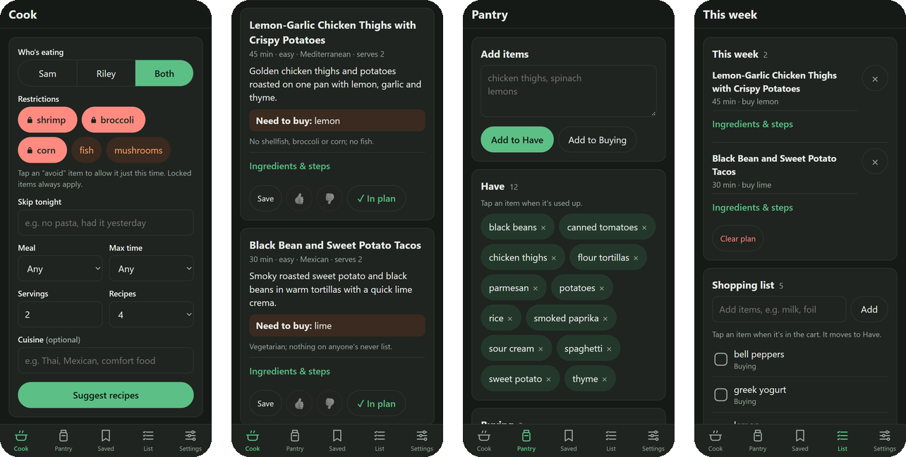
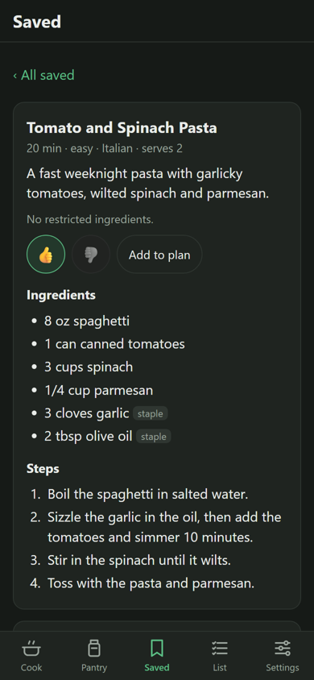
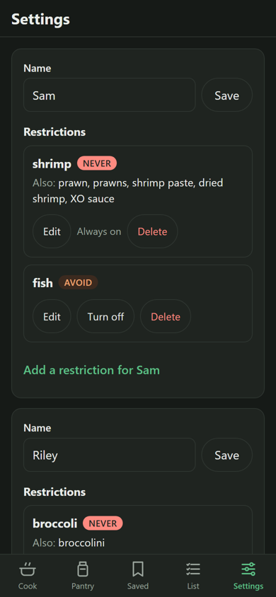

# Pantry Chef

[](https://github.com/bradzab1123/pantry-chef/actions/workflows/ci.yml)
[](LICENSE)


A self-hosted, mobile-first recipe planner for a two-person household. Tell it what's in the pantry and what you're about to buy, and Claude suggests recipes that respect each person's dietary restrictions. The extra ingredients a recipe needs go straight onto a shopping list.

<p align="center">
  
</p>

## Features

- **Recipes from what you have.** Suggestions use your pantry and staples, plus at most two things to buy.
- **Restrictions per person.** Pick who's eating and only their restrictions apply. Each one is either *never* (enforced) or *avoid* (a preference you can switch off for a single request).
- **A safety filter that doesn't trust the model.** Every recipe is checked in code against each *never* item, its aliases (e.g. "XO sauce" for shrimp) and exceptions (e.g. "cornstarch" is fine for corn), with word-boundary and plural matching. A recipe that fails gets one regenerate, then it's dropped.
- **Saved recipes and ratings.** Thumbs up and down steer future suggestions. "Spin-offs" make variations of a recipe you liked.
- **This week's plan and a shopping list.** Missing ingredients are merged into one list; checking an item off moves it into the pantry.
- **Installs like an app.** A PWA for the iPhone home screen, with a light and dark theme.
- **Small and cheap to run.** One container, SQLite, no JS framework or build step. A monthly usage and cost estimate is in Settings, and an hourly cap guards against runaway spend.

<p align="center">
  
  &nbsp;&nbsp;
  
</p>

## How it works

| Part | What it uses |
|---|---|
| Web app | [FastAPI](https://fastapi.tiangolo.com/), Jinja2 templates and [htmx](https://htmx.org/) (every form also works without JavaScript) |
| Data | SQLite through [SQLModel](https://sqlmodel.tiangolo.com/), with plain numbered SQL migrations |
| Recipes | The [Claude API](https://docs.anthropic.com/) with structured output, validated by Pydantic ([`app/llm.py`](app/llm.py)) |
| Never filter | [`app/restrictions.py`](app/restrictions.py), run on every recipe by [`app/cook.py`](app/cook.py) |
| Hosting | A Docker image built by GitHub Actions, served through Cloudflare Tunnel and Cloudflare Access |

The app has no accounts of its own. It's meant to sit behind Cloudflare Access (or another login proxy), with one shared household for the two people. [SPEC.md](SPEC.md) has the full design.

## Quick start

```bash
git clone https://github.com/bradzab1123/pantry-chef.git
cd pantry-chef
python -m venv .venv
.venv/Scripts/activate        # Windows (Git Bash); on Linux/macOS: source .venv/bin/activate
pip install -r requirements-dev.txt
export ANTHROPIC_API_KEY=sk-ant-...   # only needed to generate recipes
uvicorn app.main:app --reload
```

Open http://localhost:8000. The first visit asks for the two people's names, then takes you to Settings to add each person's restrictions.

## Contents

- [Local development](#local-development)
- [CI/CD](#cicd)
- [Deploying to the server](#deploying-to-the-server)
- [Cloudflare Tunnel and Access](#cloudflare-tunnel-and-access)
- [Updating](#updating)
- [Backups](#backups)
- [Project notes](#project-notes)
- [License](#license)

## Local development

Needs Python 3.11+ (the container and CI use 3.12). Set up as in [Quick start](#quick-start).

The SQLite database is created at `data/pantry.db` and migrated automatically on startup. Recipe generation needs `ANTHROPIC_API_KEY` set in your environment; everything else works without it.

### Configuration

The app reads these environment variables (in Docker, from `.env`; see [`.env.example`](.env.example)):

| Variable | Default | What it does |
|---|---|---|
| `ANTHROPIC_API_KEY` | (none) | Your Claude API key, from [console.anthropic.com](https://console.anthropic.com/) |
| `CLAUDE_MODEL` | `claude-haiku-5-5` | Model used for recipes |
| `MAX_GENERATIONS_PER_HOUR` | `30` | Cost guard: requests beyond this in a rolling hour are refused |
| `PRICE_INPUT_PER_MTOK`, `PRICE_OUTPUT_PER_MTOK` | `0.10`, `0.50` | US$ per million tokens, for the cost estimate in Settings |
| `DB_PATH` | `data/pantry.db` | Where the SQLite file lives |
| `TZ` | (system) | Time zone; the monthly usage in Settings resets at local midnight on the 1st |

### Tests

```bash
pytest
```

Tests use a throwaway database per test and never call the Anthropic API.

### Docker locally

```bash
cp .env.example .env    # then fill in ANTHROPIC_API_KEY, GHCR_USER, TUNNEL_NETWORK
docker network create cloudflared   # only if you don't already have the tunnel network
docker compose up --build
```

The container publishes **no ports**, so you can't open it at localhost:8000 this way. Use `uvicorn` for clicking around and Docker for checking the image builds and goes healthy (`docker compose ps`).

## CI/CD

[`.github/workflows/ci.yml`](.github/workflows/ci.yml) runs on GitHub Actions:

| Event | What happens |
|---|---|
| Pull request | `pytest` |
| Push to `main` | `pytest`, then build the image and push it to GHCR |
| Manual ("Run workflow" on the Actions tab, on `main`) | same as a push to `main` |

The image is published as:

- `ghcr.io/<github-user>/pantry-chef:latest`
- `ghcr.io/<github-user>/pantry-chef:sha-<short commit sha>` (e.g. `sha-eafbe7e`), so you can roll back to any build

No repository secrets are needed. The tests fake the Anthropic client, and the push uses the workflow's built-in `GITHUB_TOKEN`. The image is built for `linux/amd64` only.

**First push.** Create the repo on GitHub, then:

```bash
git remote add origin https://github.com/<github-user>/pantry-chef.git
git push -u origin main
```

Watch the run on the repo's **Actions** tab. When it's green, the image shows up under your GitHub profile → **Packages** → `pantry-chef`. New packages are **private** by default. Either leave it private and log in on the server (step 1 below), or make it public: open the package → **Package settings** → **Change visibility**. Nothing secret is baked into the image, since the API key comes from `.env` at runtime.

## Deploying to the server

These steps assume the app lives in `/opt/pantry-chef` on the Docker host, and that `cloudflared` already runs there as a container.

**1. Log in to GHCR** (skip this if you made the package public). Create a **classic** personal access token at GitHub → Settings → Developer settings → Personal access tokens → Tokens (classic), with only the `read:packages` scope. Then, on the server:

```bash
docker login ghcr.io -u <github-user>
```

Paste the token when it asks for a password. Docker saves it in `~/.docker/config.json`, so you only do this once.

**2. Get the compose file and settings.** The server only needs `docker-compose.yml` and a `.env`. Copy them over from your machine, for example:

```bash
sudo mkdir -p /opt/pantry-chef && sudo chown $USER /opt/pantry-chef
scp docker-compose.yml .env.example server:/opt/pantry-chef/
```

Then on the server:

```bash
cd /opt/pantry-chef
cp .env.example .env
nano .env
```

Fill in:

- `ANTHROPIC_API_KEY`: from console.anthropic.com
- `GHCR_USER`: your GitHub username, in lowercase
- `TUNNEL_NETWORK`: the Docker network your `cloudflared` container is on. Find it with:

  ```bash
  docker inspect cloudflared --format '{{range $k, $v := .NetworkSettings.Networks}}{{$k}} {{end}}'
  ```

  Use your container's name if it isn't `cloudflared`.

Then lock the file down: `chmod 600 .env`.

**3. Create the data folder.** The container runs as uid 1000, so the folder has to be writable by that uid:

```bash
mkdir -p data && sudo chown 1000:1000 data
```

**4. Start it:**

```bash
docker compose pull
docker compose up -d
docker compose ps        # STATUS should say "(healthy)" after ~30 s
docker compose logs -f   # Ctrl+C to stop following
```

The database is created and migrated on first start, at `/opt/pantry-chef/data/pantry.db`. The first visit to the app asks for the two people's names; after that, add each person's restrictions in Settings.

## Cloudflare Tunnel and Access

### Tunnel: public hostname

Point a hostname at the container. `cloudflared` reaches it by container name over the shared Docker network.

- **Tunnel managed in the dashboard:** Cloudflare Zero Trust → **Networks → Tunnels** → your tunnel → **Public Hostname** → **Add a public hostname**.
  - Subdomain and domain: e.g. `pantry` . `example.com`
  - Service: type **HTTP**, URL **`pantry-chef:8000`**
- **Tunnel managed with `config.yml`:** add a rule above the final catch-all:

  ```yaml
  ingress:
    - hostname: pantry.example.com
      service: http://pantry-chef:8000
    # ...your other hostnames...
    - service: http_status:404
  ```

  Then restart `cloudflared`.

If the hostname returns a 502, `cloudflared` and `pantry-chef` probably aren't on the same network. Check with `docker network inspect <TUNNEL_NETWORK>`.

### Access: who can log in

The app has no accounts of its own. Cloudflare Access is the only login, so set this up **before** you share the hostname.

1. Zero Trust → **Access → Applications** → **Add an application** → **Self-hosted**.
2. Application domain: `pantry.example.com`, the hostname from above.
3. **Session duration: 1 month.** The installed iPhone app keeps its own cookies, separate from Safari, so a long session means logging in roughly once a month.
4. Add a policy:
   - Action: **Allow**
   - Include → **Emails**: your two email addresses
5. Login method: the default **One-time PIN** (a code sent by email) works fine. Save.

Test it in a private browser window. You should get the Cloudflare login page, and after entering the code, the app.

### Installing on iPhone

1. Open `https://pantry.example.com` in **Safari** and log in.
2. Tap **Share** → **Add to Home Screen**.
3. Open Pantry Chef from the home screen. It runs as its own app with its own cookies, so **you'll have to log in once more inside it**. After that it stays logged in for the session duration.

## Updating

Every push to `main` publishes a new `latest`. To update the server:

```bash
cd /opt/pantry-chef
docker compose pull && docker compose up -d
```

Migrations run automatically on startup. Optionally clean up old images afterwards with `docker image prune`.

**Rolling back:** set `IMAGE_TAG` in `.env` to an earlier build, e.g. `IMAGE_TAG=sha-eafbe7e`. The tags are on the package page on GitHub. Then run `docker compose pull && docker compose up -d`. To go back to the newest build, remove the line (it defaults to `latest`). Be aware that migrations only go forward, so after a rollback an older image runs against a database that already has the newer schema. That's fine for added columns and tables, but take a [backup](#backups) before updating if a release changes the schema.

### Optional: automatic updates with Watchtower

Manual updates are the default. If you want the server to pull new builds by itself, run Watchtower alongside the app.

The original `containrrr/watchtower` was **archived in December 2025** and gets no more fixes. The maintained continuation is [`nickfedor/watchtower`](https://github.com/nicholas-fedor/watchtower), which accepts the same flags. Pin a specific version tag from its releases page rather than using `latest`.

1. Opt Pantry Chef in by adding a label to its service in `docker-compose.yml`:

   ```yaml
   services:
     pantry-chef:
       # ...
       labels:
         com.centurylinklabs.watchtower.enable: "true"
   ```

2. Run Watchtower, limited to labelled containers, checking once a night:

   ```yaml
   # e.g. /opt/watchtower/docker-compose.yml
   services:
     watchtower:
       image: nickfedor/watchtower:<version>
       restart: unless-stopped
       command: --label-enable --cleanup --schedule "0 0 4 * * *"   # 04:00 daily (6-field cron, seconds first)
       environment:
         - TZ=America/New_York
       volumes:
         - /var/run/docker.sock:/var/run/docker.sock
         # Only needed while the GHCR package is private (reuses your `docker login`):
         - /home/<you>/.docker/config.json:/config.json:ro
   ```

`--label-enable` means Watchtower ignores every container that doesn't carry the label, so it won't touch `cloudflared` or anything else on the host. Keep in mind that Watchtower has full control of Docker through the socket.

## Backups

All of the app's data is the single file `data/pantry.db`. Back it up nightly with SQLite's `.backup` command, which is safe to run while the app is running. The app image doesn't include the `sqlite3` tool, so install it on the host:

```bash
sudo apt install sqlite3
mkdir -p /opt/pantry-chef/backups
```

Then add a cron job with `sudo crontab -e`. Root's crontab avoids file-permission trouble with the uid-1000 `data/` folder.

```cron
# Pantry Chef: nightly SQLite backup at 03:15, keep 14 days
15 3 * * * sqlite3 /opt/pantry-chef/data/pantry.db ".backup /opt/pantry-chef/backups/pantry-$(date +\%F).db" && find /opt/pantry-chef/backups -name 'pantry-*.db' -mtime +14 -delete
```

The `%` must be written as `\%` inside a crontab line, because cron treats a bare `%` as a newline. To check that it works, run the command once by hand (with plain `%` in the shell) and look in `backups/`.

These backups sit on the same disk as the database. Copy `backups/` somewhere else too (another machine, a NAS, or cloud storage via `rclone`) so a dead disk doesn't take both.

**Restoring:**

```bash
cd /opt/pantry-chef
sqlite3 backups/pantry-2026-10-20.db "PRAGMA integrity_check;"   # should print "ok"
docker compose stop
cp data/pantry.db data/pantry.db.before-restore
cp backups/pantry-2026-10-20.db data/pantry.db
sudo chown 1000:1000 data/pantry.db
docker compose start
```

## Project notes

- **Migrations:** numbered SQL files in `app/migrations/`, applied in order at startup and tracked in `schema_version`. To change the schema, add a new file with the next number. Never edit a file that has already run on the server. Also update `app/models.py`; a test checks that the two match.
- **Icons:** `python scripts/make_icons.py` redraws the PNGs in `app/static/icons/`.
- **htmx** is vendored at `app/static/htmx.min.js` (v2.0.4).
- **Screenshots** in `docs/screenshots/` were taken from a local install with sample data.

## License

[MIT](LICENSE)
